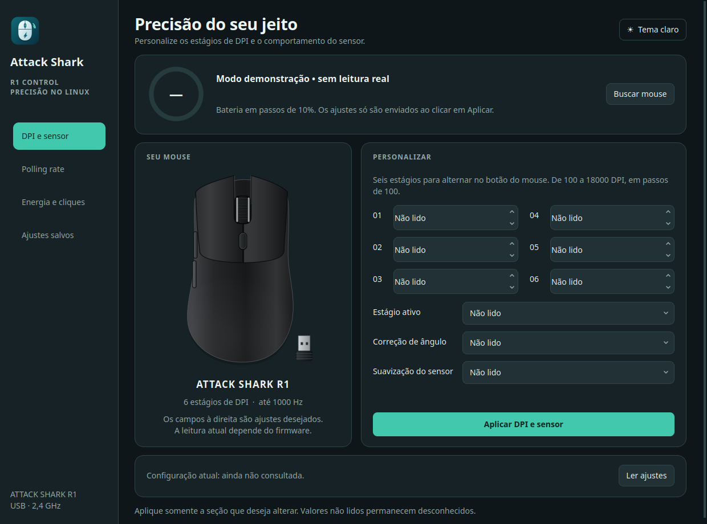

# Attack Shark R1 • Configurações e bateria

[](https://github.com/Rk7gamerYT/attack-shark-r1-control/actions/workflows/test.yml)



App Qt para Linux com ajustes do mouse e porcentagem de bateria na bandeja. Projeto
separado do PS4 Control, com implementação independente sob licença MIT.

```bash
git clone https://github.com/Rk7gamerYT/attack-shark-r1-control.git
cd attack-shark-r1-control
./run.sh
```

Requer Python 3.10+, venv e bibliotecas gráficas Qt6. O script instala PySide6
localmente. Use `./run.sh --demo` para visualizar sem acessar dispositivos.

Conecte o dongle R1 e clique em **Liberar leitura…**. O PolicyKit pede
autorização para conceder ACL de somente leitura ao hidraw da interface 2 do
receptor até desconectar/reiniciar. Requer `pkexec` e `setfacl` (PolicyKit e acl).
Não captura o mouse nem desliga seu driver de entrada.

Fechar a janela mantém o app na bandeja quando disponível. Para encerrar, use
**Sair** no menu do ícone. GNOME requer suporte a AppIndicator; sem bandeja,
fechar a janela encerra normalmente.

## Estado e limites

- Reconexão automática e leitura não bloqueante, sem espera USB infinita.
- Filtra VID 1D57, PID FA60/FA61 e interface USB 2.
- Valida tamanho, ID do relatório e intervalo de carga.
- Após 120 segundos sem relatório, mostra `?`, sem inventar porcentagem.
- A escala do protocolo de referência tem passos de 10%.
- Cabo FA61 é detectado, mas a bateria não está validada nesse modo.
- Leitura passiva HID 3 validada no receptor R1 FA60 local: relatório `03 10 40 01 08`, correspondente a 80%. Outros firmwares ainda precisam de validação.
- Configura seis estágios de DPI (100–18000 em passos de 100), estágio ativo, correção de ângulo e ripple control.
- Polling rate: 125, 250, 500 e 1000 Hz.
- Suspensão: 0,5–30 minutos; profunda: 1–60 minutos; resposta dos botões: 4–50 ms em passos de 2.
- Não implementa macros, remapeamento ou atualização de firmware.

As limitações físicas de sensor, firmware, polling rate e precisão de bateria
não podem ser removidas simplesmente retirando validações de software.

## Configurar o mouse

1. Use **Liberar alterações…** para conceder leitura e escrita
   apenas ao hidraw do receptor, via PolicyKit/ACL. A bateria sozinha exige só leitura.
2. Preencha os campos da seção desejada. **Preencher sugestão de ajustes** fornece
   um ponto de partida explicitamente identificado como sugestão.
3. **Aplicar** na seção escolhida envia somente o grupo escolhido: DPI/sensor,
   polling ou suspensão/resposta. Todos os campos daquela aba precisam ser válidos.
4. **Salvar ajustes neste computador** grava o formulário em
   `~/.config/attack-shark-r1-control/settings.json`, respeitando XDG_CONFIG_HOME.
   Salvar/carregar não aplica nada automaticamente ao dispositivo.

Aplicação ocorre em subprocesso separado, com limite de oito segundos e espera
por ACK de até dois segundos no dongle. Não há reenvio automático se a confirmação
não chegar. Um timeout não garante que o mouse rejeitou o comando. O ACK confirma
recebimento, não fornece uma leitura completa dos valores aplicados.

### Ler a configuração atual

O app tenta `GET_FEATURE` ao conectar e pelo botão **Ler ajustes**.
Somente respostas com estrutura, campos e checksum válidos entram no formulário.
No receptor FA60 testado, os relatórios 4, 5 e 6 retornaram conteúdo inválido;
nenhum ajuste atual pôde ser recuperado. Nessa situação, a tela informa a limitação
e mantém **Não lido** em campos desconhecidos, sem preencher padrões silenciosamente.
Valores digitados ou carregados de arquivo são ajustes desejados, não leitura real.

A bateria foi validada fisicamente; os comandos de configuração têm validação
por testes e ainda exigem confirmação no mouse pelo uso da interface. A compatibilidade
com outros firmwares, aplicação por cabo e persistência após desligar não foram validadas.
A leitura completa requer identificar um protocolo de consulta válido para esse firmware;
retirar validações para aceitar dados inválidos produziria valores incorretos.

## Referências

[xb-bx/attack-shark-r1-driver](https://github.com/xb-bx/attack-shark-r1-driver)
documenta IDs, interface e byte de carga. O relatório 3 com quatro bytes de dados
também foi identificado no descritor HID do receptor local. O app usa implementação Python independente e não depende de compilar código Odin.
A tabela `r1_dpi.json` contém apenas os pares de codificação DPI do protocolo, extraídos da revisão `2f46655d4e53c417ecd35089ad8bdea1d7798699` dessa referência. A leitura usa hidraw para
preservar a operação normal das entradas.

```bash
python3 -m unittest discover -s tests
QT_QPA_PLATFORM=offscreen .venv/bin/python app.py --demo --smoke-test
```

## Ícone e atalho no menu

Execute `python3 install-menu.py` para instalar o ícone e o atalho somente para o usuário atual. Procure Attack Shark R1 Control no menu de aplicativos. O ícone da janela é atualizado ao reabrir o app.

## Aparência

Botão no topo alterna entre tema escuro e claro; a escolha fica em `~/.config/attack-shark-r1-control/ui.json`.

A navegação lateral separa DPI/sensor, polling rate, energia/cliques e ajustes salvos. A ilustração do mouse é vetorial e o medidor acompanha a bateria real quando disponível.

## Dependências no Ubuntu/Debian

```bash
sudo apt install python3 python3-venv libegl1 libgl1 libxkbcommon0 acl pkexec
```

O app roda como usuário comum. Para contribuir, veja [CONTRIBUTING.md](CONTRIBUTING.md). Código sob a [licença MIT](LICENSE). Projeto independente, sem afiliação com Attack Shark.
